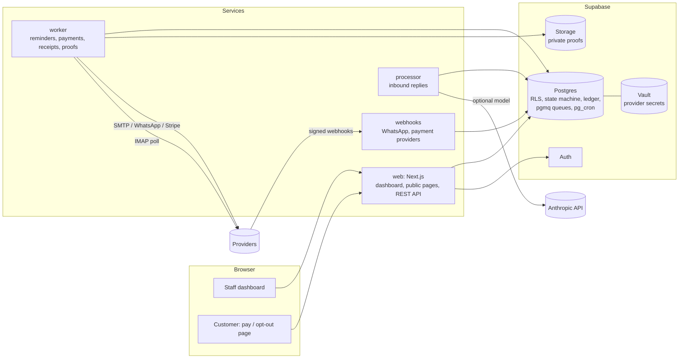

# Architecture

Written from the code and the ADRs in docs/decisions (2026-10-29). Where this page and the code disagree, the code
wins; please fix the page.

## Shape

## Layers (dependencies point inward, rule 2)

- `packages/core`: pure domain. The invoice state machine, `decide()` (what to do next for one invoice),
  `planReplyOutcome()`, money in integer minor units, send windows in IANA time zones. No I/O, no clock, no
  randomness: `now` is an argument (rule 1, ADR 0001). Imports only `luxon`, enforced by lint.
- `packages/db`, `ingest`, `messaging`, `links`, `authz`: data access, import, rendering, public links, the role
  matrix as data.
- `packages/worker`, `inbound`, `payments`, `proofs`, `webhooks`: the pipelines, each a composition root that wires
  adapters to the core.
- `packages/adapters-*`: SMTP and IMAP, WhatsApp Cloud API, Slack, Stripe, bank transfer, FakeGateway (tests and demo).
- `apps/web`: Next.js. Staff screens run as the signed-in user under RLS; trusted server actions reuse the same
  pipelines as the CLIs (ADR 0043); public pages are plain HTML route handlers (ADR 0045).
- `packages/ops`, `config`: schema guard, heartbeats, ops status, watchdog, retention, erasure; the env schema.
- Not runtime: `packages/demo`, `repo-tools`, `sim`, every `test*` and `scripts` directory.

## The database decides

- Every public table has `tenant_id` and RLS; cross-table references include `tenant_id` (rules 11, 13; ADR 0005,
  0008). Status changes go through a transition table checked by a trigger (ADR 0007).
- Mutations from the UI call RPCs that re-check role and tenant (rule 33, ADR 0042); `private.*` functions are not
  exposed by the API.
- Events are append-only (ADR 0009). The ledger keeps `received = applied + credit` per receipt (ADR 0033).

## Sending (ADR 0013-0021, 0052)

pg_cron enqueues due invoices into a pgmq queue. The worker claims a job, drops it if the invoice was rescheduled
since (ADR 0052), loads fresh context, runs `decide()`, checks approvals, consent, budget, pacing and the kill switch,
claims a stable idempotency key in the outbox, sends once, records the outcome, then acks. An outcome it cannot know
becomes `unknown`, parks the invoice and alerts a human; it is never resent automatically (rule 17).

## Replies (ADR 0022-0031)

Inbound email (IMAP poller) and WhatsApp (webhooks) are stored raw, then the processor normalises, pre-filters,
matches the reply to an invoice (ambiguous -> human task), optionally classifies it with a model (output is a
schema-validated proposal only), and applies `planReplyOutcome()` through the state machine.

## Payments (ADR 0032-0041)

Payment links are created on the business's own provider account. Confirmation comes only from a verified provider
signal (signature over the raw body, account from an opaque URL token, tenant and invoice from our rows) or from an
authorised human (manual bank transfer, confirmed proof). One pipeline applies every confirmation in a locked
transaction, idempotently per provider reference.

## Web, public pages, API (ADR 0042-0049)

Server-side auth with `getClaims()`, tenant context from a cookie re-checked in the database, polling for counters,
CSP with nonces, opaque hashed tokens for public links, Postgres-backed rate limits, a small REST API with hashed keys
and idempotency.

## Operations (ADR 0051, docs/runbook.md)

Every service checks the schema version at start and refuses to run on a mismatch. Services write heartbeats; the
watchdog alerts on stale heartbeats and thresholds. Retention, export and erasure are service-only CLIs.
